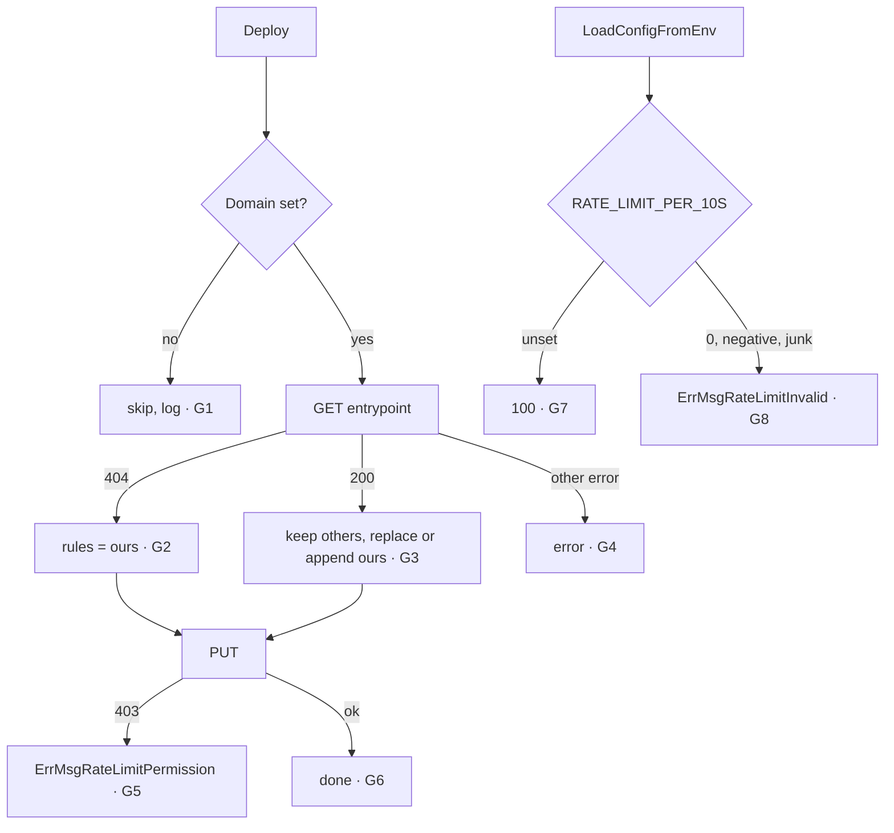

> This plan is dispatched via the CodeJob workflow. See skill: agents-workflow.

# Plan — goflare: edge rate limiting by default

Read `AGENTS.md` first. **This change is host tooling (`!wasm`): the standard
library (`net/http`, `encoding/json`, `strings`, `os`) is correct here. Do not
"fix" those imports.**

## Why

No API deployed with goflare has any throttling: login, token and
identity-resolution endpoints can be hammered without limit (OWASP API
Security Top 10 2023, API4 "Unrestricted resource consumption"; ASVS V2.2.1
anti-automation). Counting requests inside a Worker does not work, because
isolates share no memory. The industry answer for edge APIs is the CDN's own
rate limiting.

So goflare will, on every deploy that has a custom domain, ensure a Cloudflare
**rate-limiting rule** in the zone's `http_ratelimit` phase. It is **on by
default**: secure by default means the developer must not have to remember it.

The rule fits the Cloudflare Free plan constraints (period 10 s, mitigation
10 s, characteristics `cf.colo.id` + `ip.src`), so it works on every plan.

## Design gate

1. **Prior art.**
   - Cloudflare Rulesets API, `http_ratelimit` phase entrypoint (the documented
     way to manage rate-limiting rules as code).
   - Terraform's `cloudflare_ruleset` resource. It manages the whole phase
     declaratively.
   - Vercel and Netlify ship platform-level rate limiting configured beside
     the deploy.

   goflare differs from Terraform in owning **one rule identified by `ref`**
   and preserving every other rule in the phase. It must never delete rules a
   human created in the dashboard.
2. **Novice names.** Env key `RATE_LIMIT_PER_10S` (read aloud: "rate limit per
   ten seconds"); `Config.RateLimitPer10s`.
3. **Complexity ledger.** +1 config key with a safe default. 0 new commands.
   Ways to rate-limit a goflare app: 0 → 1.
4. **Where it belongs.** Deploy-time Cloudflare configuration is goflare's
   concern. The runtime (`webtyp/cloudflare`) is untouched.
5. **What it deletes.** Nothing.

## Behavior

- `Config.RateLimitPer10s int`, env `RATE_LIMIT_PER_10S`, default
  `DefaultRateLimitPer10s = 100` when unset.
- A value `< 1`, or one that does not parse as an integer, fails
  `LoadConfigFromEnv` with this error (verbatim constant
  `ErrMsgRateLimitInvalid`):
  `RATE_LIMIT_PER_10S must be an integer >= 1: the edge rate limit cannot be disabled`.
- Only when `Config.Domain != ""`. Without a custom domain there is no zone to
  attach a rule to. Log once:
  `rate limit: skipped (no DOMAIN; workers.dev has no zone rules)`.
- Runs in `Deploy` right after `configureWorkerDomain` succeeds.
- Owned rule (exact JSON):
  ```json
  {
    "ref": "goflare-<WorkerName>",
    "description": "goflare: per-IP rate limit for <Domain>",
    "expression": "(http.host eq \"<Domain>\")",
    "action": "block",
    "ratelimit": {
      "characteristics": ["cf.colo.id", "ip.src"],
      "period": 10,
      "requests_per_period": <RateLimitPer10s>,
      "mitigation_timeout": 10
    }
  }
  ```
- Algorithm:
  1. `GET /zones/{zone_id}/rulesets/phases/http_ratelimit/entrypoint`.
     - 404: there is no entrypoint yet, so the rule list is `[]`.
     - Any other error is returned.
  2. Keep every rule whose `ref` differs from ours, **unchanged** (keep each
     as `json.RawMessage`, so fields goflare does not know survive). Append
     our rule. If a rule with our `ref` existed, it is replaced, not
     duplicated.
  3. `PUT /zones/{zone_id}/rulesets/phases/http_ratelimit/entrypoint` with
     `{"rules": [...]}`.
- **Fail closed.** If the PUT returns 403 (permission), Deploy fails with
  (constant `ErrMsgRateLimitPermission`):
  `rate limit: the Cloudflare API token cannot edit the zone's rate limiting rules — grant it "Zone → Zone WAF → Edit" (the deploy refuses to ship an unthrottled API)`.
  Any other Cloudflare error is returned wrapped with `"rate limit: "`.
  A Free plan zone that already has a different rule in this phase answers
  with a quota error: that error surfaces as-is, wrapped.

## Stage 1 — implementation

1. `config.go`: `EnvKeyRateLimitPer10s = "RATE_LIMIT_PER_10S"`,
   `DefaultRateLimitPer10s = 100`. Parse it in `LoadConfigFromEnv` (`.env` file
   and OS fallback, like the other keys), validate, and apply the default.
2. `goflare.go`: `Config.RateLimitPer10s int // RATE_LIMIT_PER_10S (default 100, must be >= 1)`.
3. `cloudflare.go`:
   - Extract the zone lookup out of `configureWorkerDomain` into
     `func (g *Goflare) matchZone(client *CfClient) (string, error)`.
     `configureWorkerDomain` uses it.
   - New `func (g *Goflare) ensureRateLimitRule(client *CfClient, zoneID string) error`
     implementing the algorithm. Path constant:
     `rateLimitEntrypointPath = "/zones/%s/rulesets/phases/http_ratelimit/entrypoint"`.
   - `Deploy`: after the domain step, call it with the zone id.
   - `CfClient` has `get`/`put`. If `get` does not expose the HTTP status
     needed to tell 404 apart, add a small unexported helper that returns the
     status with the body. Do not change `get`'s existing callers.
4. `goflare.New(cfg)` (the programmatic constructor used by tests) applies
   the same default when `RateLimitPer10s == 0`, because tests and callers
   build `Config` directly.

## Stage 2 — tests (`tests/deploy_ratelimit_test.go`)

Reuse `MockHTTPServer`, `withCloudflareToken`, `newTestEnv` from the existing
tests. **Update every existing deploy test whose `Config` has a `Domain`**
(e.g. `tests/deploy_worker_domain_test.go`) so its mock answers the two
ruleset calls (`GET` → 404, `PUT` → 200). Otherwise they fail for an
unrelated reason.



| Branch | Test |
|---|---|
| G1 | no `Domain`: no request to `/rulesets/` is made |
| G2 | GET 404 → PUT body has exactly our rule with `requests_per_period` 100 and expression `(http.host eq "api.velty.cl")` |
| G3 | GET returns a foreign rule `{"ref":"manual","id":"r1","description":"x","expression":"true","action":"block","ratelimit":{...},"extra_field":7}` plus an old `goflare-my-worker` rule → PUT body contains `manual` byte-for-byte (including `extra_field`), and exactly one `goflare-my-worker` with the new values |
| G4 | GET 500 → Deploy error contains `rate limit` |
| G5 | PUT 403 → Deploy error equals the permission message |
| G6 | happy path, `RateLimitPer10s: 40` → body has 40 |
| G7 | `tests/config_test.go`: unset → 100 |
| G8 | `"0"`, `"-5"`, `"abc"` → `ErrMsgRateLimitInvalid` |

## Stages

| # | Files | Done when |
|---|---|---|
| 1 | `config.go`, `goflare.go`, `cloudflare.go` | compiles |
| 2 | `tests/deploy_ratelimit_test.go`, `tests/config_test.go`, every existing deploy test with a `Domain` (mock updated) | G1–G8 green, no regression |
| 3 | `README.md` (new section "Rate limiting": default, env key, required token permission, Free-plan note), `docs/` deploy doc if it lists required token permissions | docs match |

`action.yml` is generated: if the GitHub Action must pass the new env key,
change `action_data.go` and regenerate via `go test ./tests/`. Never edit
`action.yml` by hand.

## Acceptance criteria

- `gotest` green.
- Before opening the PR: `git diff --stat main` lists every file of the
  stages table, and no file is deleted that this plan does not order deleted.


## Executor notes
Implemented the feature as requested. All test cases passed and there were no deviations from the plan.
